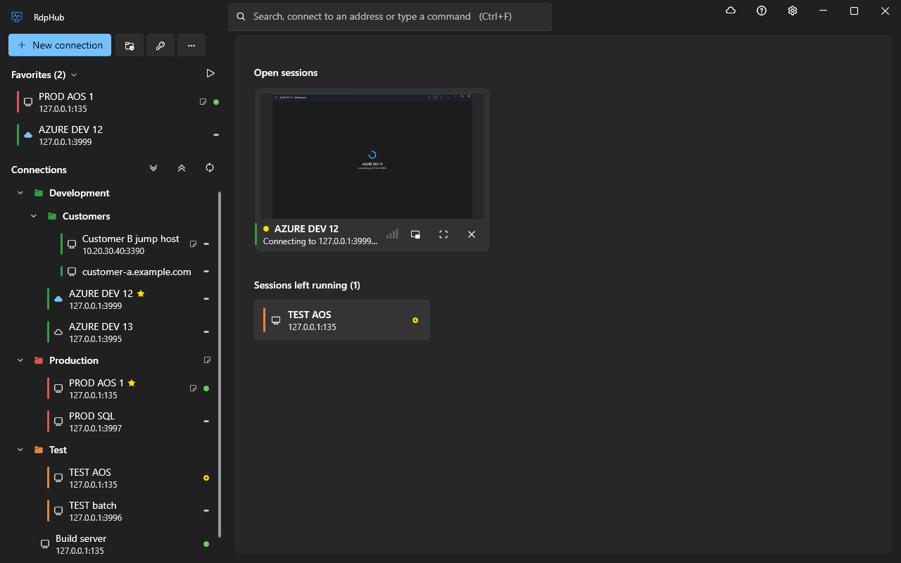
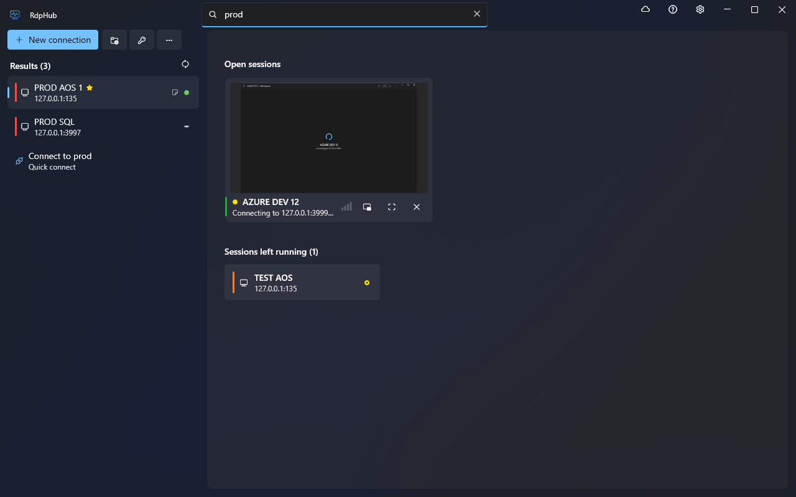
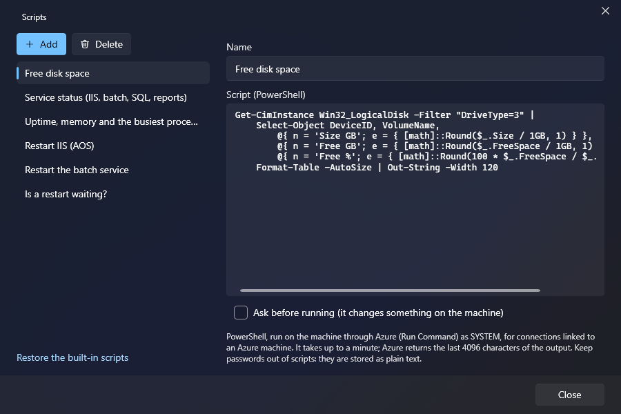

# Sessionwright

A remote desktop (RDP) connection manager for Windows, built for people who work on many servers and Azure virtual machines every day. Fluent look, one window per session, and the things around a session that usually take a second tool: starting the machine, seeing who is signed in, running a script on it.

[](https://github.com/Patri0s/Sessionwright/actions/workflows/build.yml)
[](https://github.com/Patri0s/Sessionwright/releases/latest)




[Polski opis](docs/README.pl.md)

## Contents

- [What it does](#what-it-does)
- [Install](#install)
- [First steps](#first-steps)
- [Keyboard](#keyboard)
- [Azure](#azure)
- [Your data](#your-data)
- [Known limits](#known-limits)
- [Build from source](#build-from-source)
- [Releasing](#releasing)
- [Built with](#built-with)

## What it does

### Connections

- A tree of connections in nested groups, with drag and drop, favorites (Ctrl+1…9) and multiple selection.
- A credential library. Passwords are encrypted for your Windows account (DPAPI) and can be inherited from a group.
- RDP settings inherited the same way: connection → nearest group → defaults.
- Environment colors (red for production, say) shown on the row, the session window and the full-screen bar.
- Notes and web links on a connection or a group; a group's link can be a template (`https://{name}.example.com`).
- One search box that finds a connection, connects to an address you type, and runs commands ("start vm-12", "who is on srv01").
- Import from `.rdp`, Remote Desktop Connection Manager (`.rdg`) and mRemoteNG (`confCons.xml`); export with passwords protected by a password of your choice.

### Sessions

- Every session in its own window with its own taskbar entry. The remote resolution follows the window.
- Full screen on any monitor, on all of them, or on the ones you pick; drag the bar to another monitor and the session follows.
- No picture jumps: switching between window and full screen happens under a short cover that lifts once the server has repainted.
- Sign out, Ctrl+Alt+Del and reconnect from the title bar, the full-screen bar and the taskbar thumbnail.
- A small always-on-top view of a session, to keep an eye on a long build while you work elsewhere.
- Sessions you disconnected without signing out are remembered and shown, so nothing keeps running on a server by accident.



### Machines

- Link a connection to an Azure VM: its state shows next to the connection, and connecting starts a machine that is off (after asking).
- Start, shut down (deallocate), restart; postpone or skip the auto-shutdown; start machines ahead of the working day.
- See who is signed in on a server and sign them out or disconnect them, without opening a session.
- A script library: run PowerShell on the machine behind a connection and read the output in a window. Comes with disk space, service status, uptime, restart IIS, restart the batch service, pending reboot.



## Install

Requires Windows 10 or 11 (x64). No administrator rights needed.

1. Download `Sessionwright-win-Setup.exe` from the [latest release](https://github.com/Patri0s/Sessionwright/releases/latest).
2. Run it. Sessionwright installs for the current user into `%LocalAppData%\Sessionwright`.

Prefer no installer? `Sessionwright-win-Portable.zip` from the same page runs from any folder.

The installer is not code-signed yet, so Windows SmartScreen may show "Windows protected your PC". Choose **More info → Run anyway**.

Sessionwright checks for updates in the background and installs a new version when you confirm, or at the next start.

## First steps

1. **Add a connection**: *New connection*, type the host, pick or create a credential.
2. **Connect**: double-click it, or press Ctrl+F, type part of its name and press Enter.
3. **Group and color**: drag connections into groups; give a group a color and a credential, and everything in it inherits both.

Coming from another tool? *More → Import* reads `.rdp`, `.rdg` and mRemoteNG files.

## Keyboard

| Keys | Action |
|---|---|
| Ctrl+F | Search, connect to an address, or run a command |
| Ctrl+N | New connection |
| Ctrl+1…9 | Connect to that favorite |
| Enter / F2 / Del | Connect / edit / delete the selected item |
| Shift+↑/↓, Ctrl+A | Select several connections |
| Ctrl+Z | Undo the delete just made |
| Ctrl+M | Azure machines |
| Ctrl+, | Settings |
| F1 | All shortcuts |
| Ctrl+Alt+Enter (in a session) | Full screen on / off |
| Ctrl+Alt+← / → (in a session) | Previous / next open session |
| Ctrl+Alt+↓ | Session switcher |

A global key (set in Settings) brings Sessionwright forward with the search ready, from anywhere in Windows.

## Azure

Sign in under *Settings → Azure accounts*, then link a connection to a VM in its editor. Sessionwright talks to Azure Resource Manager as you; what works depends on your role on the machine:

| Feature | Needs |
|---|---|
| State, start, shut down, restart | `Microsoft.Compute/virtualMachines/*` actions (e.g. Virtual Machine Contributor) |
| Postpone or skip the auto-shutdown | `Microsoft.DevTestLab/schedules/write` on the resource group |
| Scripts, signed-in users through Azure | `Microsoft.Compute/virtualMachines/runCommand/action` |

Scripts run through Azure Run Command: no port has to be open, the script runs as SYSTEM, takes up to a minute, and Azure allows one command at a time per machine.

## Your data

- Everything is in `%APPDATA%\Sessionwright\data.json` (set `SESSIONWRIGHT_DATA` to use another path). It is written atomically with a backup copy, and a damaged file is kept and restored from the last good one.
- Passwords are encrypted with Windows DPAPI for your account: the file is useless on another account or PC. Azure tokens live in the encrypted MSAL cache, never in the data file.
- One Sessionwright uses a data file at a time; a second one (another Windows session, another PC on the same file) says so instead of overwriting changes.
- No telemetry. Sessionwright connects only to your servers, to Azure (when you sign in) and to the update feed.
- A diagnostic log is at `%APPDATA%\Sessionwright\sessionwright.log`. *Settings → Updates and data → Save a problem report* makes a zip with the log and the data file stripped of passwords, notes, script text and the secret parts of link addresses.

## Known limits

- **Sign-out** uses the server's Remote Desktop Services API when port 445 answers. Otherwise it types `logoff` into the session's Run box under a cover, which depends on the keyboard and the session's state.
- **Opening a link in a session** is typed the same way; RDP has no channel for it.
- **Scripts** need an Azure-linked connection. The service names in the built-in Dynamics 365 scripts fit a standard development VM and may need editing for yours.
- **The small view** shows the session window's own picture: a minimized session window has none.
- **Picking monitors** for full screen was verified with two monitors.
- Updates are taken from https or a folder only, and the installer is unsigned for now.

## Build from source

Requires the .NET 10 SDK.

```bash
dotnet build
dotnet test
dotnet run --project src/Sessionwright
```

Layout:

| Path | What |
|---|---|
| `src/Sessionwright` | The application (WPF). `RdpSession` hosts the RDP ActiveX control, `SessionWindow` owns one session, `Store` reads and writes the data file, `AzureVms` talks to Azure. |
| `tests/Sessionwright.Tests` | Unit tests of the data layer, importers, Azure parsing and other logic without a window. |
| `build/publish.ps1` | Packs a release (installer, portable zip, update packages). |
| `.github/workflows` | Build and test on every push; release on a `v*` tag. |

Texts are in `src/Sessionwright/Loc.cs` (English and Polish side by side). User-visible changes go into `src/Sessionwright/WhatsNew.cs`, which the app shows after an update.

## Releasing

Push a version tag and GitHub Actions tests, builds and publishes the release:

```powershell
git tag v1.1.0
git push origin v1.1.0
```

Locally, `build/publish.ps1 -Version 1.1.0 -UpdateFeed https://github.com/Patri0s/Sessionwright -Upload` does the same; `-SignParams` or `-AzureTrustedSignFile` signs the installer. Details are in the script's header.

## Built with

[WPF-UI](https://github.com/lepoco/wpfui) · [Velopack](https://github.com/velopack/velopack) · [CommunityToolkit.Mvvm](https://github.com/CommunityToolkit/dotnet) · [Azure.Identity](https://github.com/Azure/azure-sdk-for-net) · the Remote Desktop ActiveX control that ships with Windows (`mstscax.dll`)
