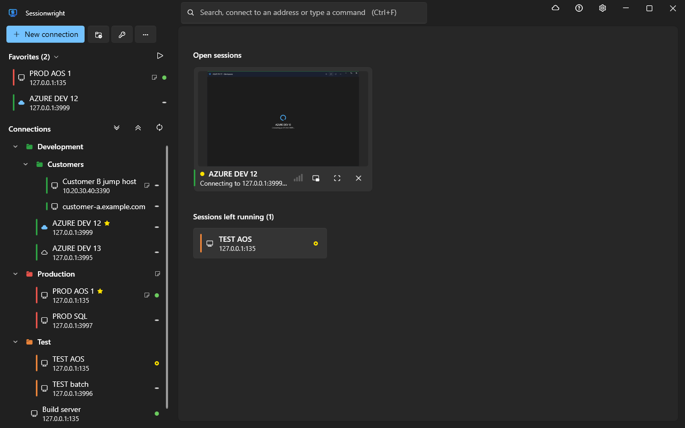
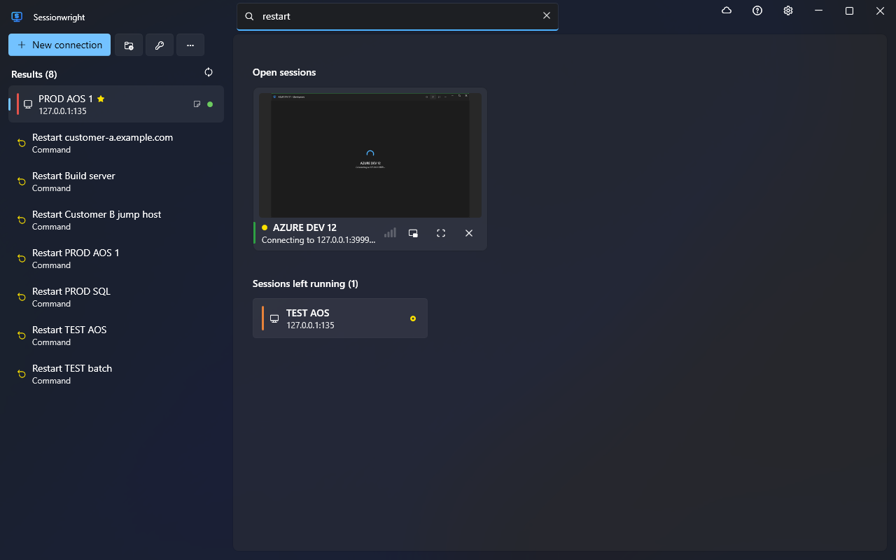
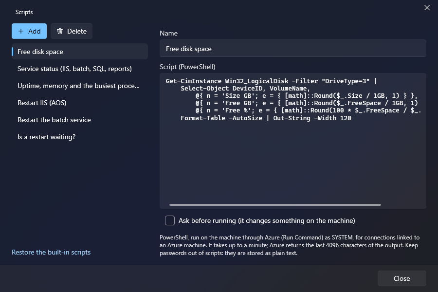

<div align="center">


# Sessionwright

**Menedżer pulpitu zdalnego dla tych, którzy pracują na wielu serwerach.**

Każda sesja we własnym oknie, wygląd Fluent i wszystko wokół sesji, do czego zwykle potrzeba drugiego narzędzia:<br>
uruchomienie maszyny, sprawdzenie, kto jest zalogowany, wykonanie na niej skryptu.

[](https://github.com/Patri0s/Sessionwright/actions/workflows/build.yml)
[](https://github.com/Patri0s/Sessionwright/releases/latest)


[](../LICENSE)

[**Pobierz**](https://github.com/Patri0s/Sessionwright/releases/latest) ·
[Funkcje](#funkcje) ·
[Pierwsze kroki](#pierwsze-kroki) ·
[Azure](#azure) ·
[Dane](#dane-i-prywatność) ·
[English](../README.md)

<br>



</div>

## Dlaczego Sessionwright

- **Sesje są oknami.** Każda ma własną pozycję na pasku zadań, pamięta monitor i rozmiar i przechodzi w pełny ekran na wybranych monitorach.
- **Bez przeskoków obrazu.** Zmiana okno ↔ pełny ekran odbywa się pod krótką zasłoną, która znika, gdy serwer narysuje pulpit w nowej rozdzielczości.
- **Maszyna jest częścią połączenia.** Uruchom wyłączoną maszynę Azure, odłóż jej automatyczne wyłączenie, sprawdź, kto jest zalogowany, wykonaj skrypt — bez wychodzenia z aplikacji.
- **Nic nie zostaje przypadkiem.** Sesje rozłączone bez wylogowania są zapamiętywane i pokazywane, więc nic nie działa na serwerze bez Twojej wiedzy.
- **Prywatność.** Hasła są szyfrowane dla Twojego konta Windows, nie ma telemetrii, a aplikacja łączy się tylko z Twoimi serwerami, Azure i źródłem aktualizacji.

## Funkcje

<table>
<tr>
<td width="33%" valign="top">

### Połączenia

- Zagnieżdżone grupy, przeciąganie i upuszczanie
- Ulubione pod <kbd>Ctrl</kbd>+<kbd>1</kbd>…<kbd>9</kbd>
- Biblioteka poświadczeń dziedziczonych z grup
- Tak samo dziedziczone ustawienia RDP
- Kolory środowisk, notatki i linki
- Import z `.rdp`, RDCMan i mRemoteNG

</td>
<td width="33%" valign="top">

### Sesje

- Jedno okno na sesję
- Rozdzielczość podąża za oknem
- Pełny ekran na jednym, wszystkich lub wybranych monitorach
- Wylogowanie, <kbd>Ctrl</kbd>+<kbd>Alt</kbd>+<kbd>Del</kbd>, ponowne łączenie
- Mały podgląd zawsze na wierzchu
- Jakość łącza widoczna od razu

</td>
<td width="33%" valign="top">

### Maszyny

- Stan maszyny Azure przy połączeniu
- Uruchamianie, wyłączanie, restart
- Odłożenie lub pominięcie automatycznego wyłączenia
- Uruchamianie maszyn przed początkiem pracy
- Zalogowani użytkownicy: wylogowanie lub rozłączenie
- Biblioteka skryptów z wynikiem w oknie

</td>
</tr>
</table>

### Wyszukiwarka, która jest też wierszem poleceń

Naciśnij <kbd>Ctrl</kbd>+<kbd>F</kbd> i pisz. To samo pole znajduje połączenie, łączy z wpisanym adresem i wykonuje polecenia: `uruchom vm-12`, `uruchom ponownie prod`, `zalogowani na srv01`. Klawisz globalny (ustawiany w Ustawieniach) przywołuje ją z dowolnego miejsca w Windows.

<div align="center">

</div>

### Skrypty na maszynie

Uruchom PowerShell na maszynie połączenia i przeczytaj wynik w oknie. Nie trzeba otwierać żadnego portu: skrypty idą przez Azure Run Command. Wbudowane: wolne miejsce na dyskach, stan usług, czas działania i najbardziej obciążające procesy, restart IIS, restart usługi batch, oczekujący restart. Własne dodasz w *Więcej → Skrypty*.

<div align="center">

</div>

### Więcej szczegółów

<details>
<summary><b>Połączenia</b></summary>

- Drzewo połączeń w zagnieżdżonych grupach, przeciąganie i upuszczanie, ulubione, zaznaczanie wielu naraz.
- Biblioteka poświadczeń. Hasła są szyfrowane dla Twojego konta Windows (DPAPI) i mogą być dziedziczone z grupy.
- Ustawienia RDP dziedziczone tak samo: połączenie → najbliższa grupa → ustawienia domyślne.
- Kolory środowisk (np. czerwony dla produkcji) widoczne w wierszu, w oknie sesji i na pasku pełnego ekranu.
- Notatki i linki przy połączeniu lub grupie; link grupy może być szablonem (`https://{name}.example.com`).
- Dostępność hostów widoczna od razu (test TCP portu RDP).
- Polecenie uruchamiane przed połączeniem, np. VPN: tylko wtedy, gdy serwer nie odpowiada, a sesja łączy się, gdy odpowie.
- Linki `sessionwright://`: *Kopiuj link do połączenia*, wklej do wiki albo czatu, a kliknięcie otworzy ten sam serwer u każdego, kto ma Sessionwright, z jego własnymi poświadczeniami. Serwer spoza listy wymaga potwierdzenia.
- Import z `.rdp`, Remote Desktop Connection Manager (`.rdg`) i mRemoteNG (`confCons.xml`); eksport z hasłami chronionymi wybranym hasłem.

</details>

<details>
<summary><b>Sesje</b></summary>

- Każda sesja we własnym oknie z własną pozycją na pasku zadań. Rozdzielczość zdalna podąża za oknem.
- Pełny ekran na dowolnym monitorze, na wszystkich albo na wybranych; przeciągnij pasek na inny monitor, a sesja przejdzie za nim.
- Własny ekran statusu podczas łączenia i logowania oraz jednozdaniowy komunikat, gdy połączenie się nie uda.
- Wylogowanie, Ctrl+Alt+Del i ponowne łączenie z paska tytułu, paska pełnego ekranu i miniatury na pasku zadań.
- Mały podgląd sesji zawsze na wierzchu, żeby mieć oko na długi build podczas innej pracy.
- Każde połączenie otwiera się tam, gdzie było ostatnio: monitor, pozycja i rozmiar.
- Ulubione i ostatnie połączenia na liście szybkiego dostępu na pasku zadań.

</details>

<details>
<summary><b>Maszyny</b></summary>

- Powiąż połączenie z maszyną Azure: jej stan widać przy połączeniu, a łączenie uruchamia wyłączoną maszynę (po zapytaniu).
- Uruchamianie, wyłączanie (zwolnienie zasobów), restart; odłożenie lub pominięcie automatycznego wyłączenia; uruchamianie maszyn przed początkiem pracy.
- Podgląd zalogowanych na serwerze oraz ich wylogowanie lub rozłączenie bez otwierania sesji.
- Biblioteka skryptów: PowerShell uruchamiany na maszynie, wynik i błędy w oknie.

</details>

<details>
<summary><b>Sama aplikacja</b></summary>

- Polski i angielski, motyw jasny, ciemny i o wysokim kontraście, obsługa czytników ekranu.
- Aktualizuje się w tle; po aktualizacji pokazuje „Co nowego”.
- Może działać w obszarze powiadomień i uruchamiać się razem z Windows.

</details>

## Pierwsze kroki

### Instalacja

Wymaga Windows 10 lub 11 (x64). Uprawnienia administratora nie są potrzebne.

1. Pobierz **`Sessionwright-win-Setup.exe`** z [najnowszego wydania](https://github.com/Patri0s/Sessionwright/releases/latest).
2. Uruchom go. Sessionwright instaluje się dla bieżącego użytkownika w `%LocalAppData%\Sessionwright`.

Bez instalatora: **`Sessionwright-win-Portable.zip`** z tej samej strony działa z dowolnego folderu. Do wdrożeń na wielu komputerach jest tam też **`Sessionwright-win.msi`**.

Instalator dodaje skrót na pulpicie i w menu Start; każdy z nich można usunąć w *Ustawienia → Ogólne*. Odinstalowanie pyta, czy zachować połączenia i ustawienia, czy je usunąć.

> [!NOTE]
> Instalator nie jest jeszcze podpisany, więc Windows SmartScreen może pokazać „System Windows ochronił ten komputer”. Wybierz **Więcej informacji → Uruchom mimo to**.

Sessionwright sprawdza aktualizacje w tle i instaluje nową wersję po potwierdzeniu albo przy następnym uruchomieniu.

### Pierwsze połączenie

1. **Dodaj połączenie** — *Nowe połączenie*, wpisz host, wybierz lub utwórz poświadczenie.
2. **Połącz** — dwuklik albo <kbd>Ctrl</kbd>+<kbd>F</kbd>, fragment nazwy i <kbd>Enter</kbd>.
3. **Grupuj i koloruj** — przeciągnij połączenia do grup; nadaj grupie kolor i poświadczenie, a wszystko w niej je odziedziczy.

Przechodzisz z innego narzędzia? *Więcej → Import* czyta pliki `.rdp`, `.rdg` i mRemoteNG.

### Klawiatura

| Klawisze | Działanie |
|---|---|
| <kbd>Ctrl</kbd>+<kbd>F</kbd> | Szukaj, połącz z adresem albo wykonaj polecenie |
| <kbd>Ctrl</kbd>+<kbd>N</kbd> | Nowe połączenie |
| <kbd>Ctrl</kbd>+<kbd>1</kbd>…<kbd>9</kbd> | Połącz z ulubionym o tym numerze |
| <kbd>Enter</kbd> / <kbd>F2</kbd> / <kbd>Del</kbd> | Połącz / edytuj / usuń zaznaczony element |
| <kbd>Shift</kbd>+<kbd>↑</kbd>/<kbd>↓</kbd>, <kbd>Ctrl</kbd>+<kbd>A</kbd> | Zaznacz kilka połączeń |
| <kbd>Ctrl</kbd>+<kbd>Z</kbd> | Cofnij ostatnie usunięcie |
| <kbd>Ctrl</kbd>+<kbd>M</kbd> | Maszyny Azure |
| <kbd>Ctrl</kbd>+<kbd>,</kbd> | Ustawienia |
| <kbd>F1</kbd> | Wszystkie skróty |
| <kbd>Ctrl</kbd>+<kbd>Alt</kbd>+<kbd>Enter</kbd> (w sesji) | Pełny ekran / wyjście z pełnego ekranu |
| <kbd>Ctrl</kbd>+<kbd>Alt</kbd>+<kbd>←</kbd> / <kbd>→</kbd> (w sesji) | Poprzednia / następna otwarta sesja |
| <kbd>Ctrl</kbd>+<kbd>Alt</kbd>+<kbd>↓</kbd> | Przełącznik sesji |

## Azure

Zaloguj się w *Ustawienia → Konta Azure*, a potem powiąż połączenie z maszyną w jego edytorze. Sessionwright rozmawia z Azure Resource Manager w Twoim imieniu; to, co działa, zależy od Twojej roli na maszynie:

| Funkcja | Wymaga |
|---|---|
| Stan, uruchamianie, wyłączanie, restart | akcji `Microsoft.Compute/virtualMachines/*` (np. Virtual Machine Contributor) |
| Odłożenie lub pominięcie automatycznego wyłączenia | `Microsoft.DevTestLab/schedules/write` w grupie zasobów |
| Skrypty, zalogowani użytkownicy przez Azure | `Microsoft.Compute/virtualMachines/runCommand/action` |

Skrypty idą przez Azure Run Command: skrypt działa jako SYSTEM, trwa do minuty, a Azure pozwala na jedno polecenie naraz na maszynę.

## Dane i prywatność

| | |
|---|---|
| **Gdzie** | Wszystko jest w `%APPDATA%\Sessionwright\data.json` (inna ścieżka: zmienna `SESSIONWRIGHT_DATA`). Plik jest zapisywany atomowo z kopią zapasową, a uszkodzony zostaje zachowany i odtworzony z ostatniej poprawnej kopii. |
| **Hasła** | Szyfrowane przez Windows DPAPI dla Twojego konta: plik jest bezużyteczny na innym koncie lub komputerze. Tokeny Azure są w szyfrowanej pamięci MSAL, nigdy w pliku danych. |
| **Jeden zapisujący** | Z jednego pliku danych korzysta naraz jeden Sessionwright; drugi informuje o tym, zamiast nadpisywać zmiany. |
| **Telemetria** | Brak. Sessionwright łączy się tylko z Twoimi serwerami, z Azure (po zalogowaniu) i ze źródłem aktualizacji. |
| **Diagnostyka** | Dziennik jest w `%APPDATA%\Sessionwright\sessionwright.log`. *Ustawienia → Aktualizacje i dane → Zapisz raport problemu* tworzy zip z dziennikiem i plikiem danych bez haseł, notatek, treści skryptów i tajnych części adresów linków. |

Więcej w [SECURITY.md](../SECURITY.md).

## Znane ograniczenia

- **Wylogowanie** używa interfejsu usług pulpitu zdalnego serwera, gdy odpowiada port 445. W przeciwnym razie wpisuje `logoff` w oknie Uruchom sesji pod zasłoną, co zależy od klawiatury i stanu sesji.
- **Otwieranie linku w sesji** jest wpisywane tak samo; RDP nie ma do tego kanału.
- **Skrypty** wymagają połączenia powiązanego z Azure. Nazwy usług we wbudowanych skryptach Dynamics 365 pasują do standardowej maszyny deweloperskiej i mogą wymagać zmiany.
- **Mały podgląd** pokazuje obraz okna sesji: zminimalizowane okno go nie ma.
- **Wybór monitorów** dla pełnego ekranu był sprawdzany na dwóch monitorach.
- **Aktualizacje** pochodzą z wydań tego repozytorium, a instalator nie jest na razie podpisany.

## Budowanie ze źródeł

Wymaga .NET 10 SDK.

```bash
dotnet build
dotnet test
dotnet run --project src/Sessionwright
```

| Ścieżka | Co zawiera |
|---|---|
| `src/Sessionwright` | Aplikacja (WPF). `RdpSession` hostuje kontrolkę ActiveX RDP, `SessionWindow` obsługuje jedną sesję, `Store` czyta i zapisuje plik danych, `AzureVms` rozmawia z Azure. |
| `tests/Sessionwright.Tests` | Testy jednostkowe warstwy danych, importów, parsowania odpowiedzi Azure i innej logiki bez okna. |
| `build/publish.ps1` | Pakuje wydanie (instalator, zip, pakiety aktualizacji). |
| `.github/workflows` | Build i testy przy każdym wypchnięciu; wydanie po tagu `v*`. |

Teksty są w `src/Sessionwright/Loc.cs` (angielski i polski obok siebie). Zmiany widoczne dla użytkownika trafiają do `src/Sessionwright/WhatsNew.cs`, który aplikacja pokazuje po aktualizacji.

<details>
<summary><b>Wydanie nowej wersji</b></summary>

<br>

Wypchnij tag wersji, a GitHub Actions przetestuje, zbuduje i opublikuje wydanie:

```powershell
git tag v1.1.0
git push origin v1.1.0
```

Lokalnie to samo robi skrypt (token z `GITHUB_TOKEN` albo z zalogowanego GitHub CLI):

```powershell
./build/publish.ps1 -Version 1.1.0 -UpdateFeed https://github.com/Patri0s/Sessionwright -Upload
```

- Źródłem aktualizacji może być repozytorium GitHub, folder (UNC lub lokalny) albo adres https z plikami wydania; zwykłe http jest odrzucane.
- `-UpdateFeed` wbudowuje źródło aktualizacji w program.
- Skrypt pobiera poprzednie wydanie ze źródła, więc klienci ściągają tylko pakiet różnicowy.
- Podpisywanie: `-SignParams` (certyfikat z magazynu Windows) albo `-AzureTrustedSignFile` (Azure Trusted Signing). Szczegóły są w nagłówku skryptu.

</details>

## Współpraca

Zgłoszenia błędów, pomysły i pull requesty są mile widziane — zobacz [CONTRIBUTING.md](../CONTRIBUTING.md). Lukę bezpieczeństwa zgłoś prywatnie, jak opisano w [SECURITY.md](../SECURITY.md).

## Licencja

Sessionwright jest udostępniany na [licencji MIT](../LICENSE). Licencje komponentów, z których jest zbudowany, są w [THIRD-PARTY-NOTICES.md](../THIRD-PARTY-NOTICES.md).

## Zbudowane z

[WPF-UI](https://github.com/lepoco/wpfui) · [Velopack](https://github.com/velopack/velopack) · [CommunityToolkit.Mvvm](https://github.com/CommunityToolkit/dotnet) · [Azure.Identity](https://github.com/Azure/azure-sdk-for-net) · kontrolka ActiveX pulpitu zdalnego dostarczana z Windows (`mstscax.dll`)
